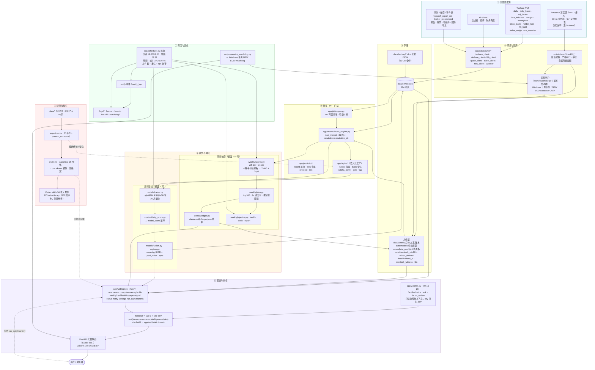

# 系统架构图（2026-09-17 全面重扫后确认）

> 口径：本图是**结构**（谁连谁），不是读数。数字/口径看 `02`，实验结论看 `05`，运行步骤看 `03`。
> 绘制前已对 `D:\NEW ECO` 逐层实扫（顶层目录、`app/*` 各包模块与行数、`main.py` 挂载、`scheduler.py` 档位、
> `app/web/llm.py`、`frontend/`、`data/` 各级文件数、`git ls-files`、两个 Windows 计划任务）。
>
> ⚠️ **2026-09-24 数字刷新**：③存储节点的表数 **95 → 194**（`sqlite_master` 实读；增量来自
> `model_*` 实验表，**不是**新业务表）。**结构性结论未变**，只是那个数字过期了。
> 表清单与"哪些是生产表 / 哪些是实验产物 / 能否再生"见 `04_数据与产物地图.md` 与
> `07` 号 #63 同轮的 `docs/db_table_index.md`（本轮新增）。

## 怎么读这张图

- **横线是主链路**：①源 → ②采集 → ③存储 → ④特征/PIT/门禁 → ⑤模型 → ⑥服务 → 用户。
- **两条产线在 ⑤ 分流**：月频基线（2 万纸面，trainer→model_score）与周频袖套（100 万纸面，W5+pit→构型→账本），两者物理隔离（库表 vs `data/weekly/ledger.json`）。
- **⑦运维**是"外部驱动"：Windows 计划任务管自愈（看门狗 + 采集链），进程内 scheduler 管档位，两者互相不分管（见 `07` 号 #58）。
- **⑧研究与知识**是"外部约束"：预注册（`plans/`）→ 实验（`experiments/`）→ 结论进 `D:\know`；门禁（`app/alpha/*`）与 `alpha_bank` 是唯一判决入口。

## 本次重扫确认到的变更（相对 09-13/09-14 的知识库）

| # | 变更 | 影响面 |
|---|---|---|
| 1 | **前端改为 Vue 3 + Vite SPA**：`frontend/`（src: views/components/intelligence/styles）→ `vite build` → `app/web/static/assets`，服务端只托管 | ⑥；旧 `app.js`/`echarts.min.js` 已从仓库删除 |
| 2 | **新增 LLM 网关** `app/web/llm.py`（09-16）：`/api/llm/{status,ask,factor_review}`；配置只在 `.env`（`LLM_API_KEY/BASE_URL/MODEL`）；定位"研究辅助，不是判决者" | ⑥；配套 `scripts/llm_factor_review.py` + `data/llm/` |
| 3 | **新增 baostock 第三源**（09-17）：60min 全市场（5,444 文件）+ 每日全市场证券列表见证 + Tushare 分红送转补库 | ①②③；纪律见 `09` |
| 4 | **`plans/` 回归**：4 份 09-17 预注册（kg-event-graph-round2 / llm-crowding-excluder-round3 / llm-factor-round / negative-excluder-round4） | ⑧ |
| 5 | **新增 Windows 计划任务** `NEW ECO Baostock Chain`（10 min，幂等启动器 + 守护） | ⑦；与 `NEW ECO Watchdog` 并列 |
| 6 | 知识/工具面：800 因子卡迁至 `D:\factor-library`；skills 目录 34 项（含 `context-budget` / `i-have-adhd` / `playwright` / `jupyter-notebook` / `security-threat-model`） | ⑧ |

## ⚠️ 构建产物累积：**有意设计，别自动清**（2026-09-17 实测 + 一次"清了又回滚"）

**现象**：`app/web/static/assets/` 93 文件 / 7.1 MB，`index-*.js` 与 `ChartLine-*.js` 各 **10 份**（每份 ChartLine ≈ 558 KB）。

**真因（实读 `frontend/vite.config.js`）**：`build.emptyOutDir: false` —— **刻意不清输出目录**。注释原文：
"清空会删掉旧哈希 chunk，**用户开着旧标签页时切视图触发懒加载 404 ⇒ 整页卡死（"无法正常使用"）**；
保留旧产物：index.html 永远指向最新哈希，旧文件只是闲置；**偶尔手动清一次即可**"。

**今天发生过什么（留痕，防复发）**：我按"入口闭包"（`index.html` → 入口 JS 的 import 闭包）算出
真正在用的 **10 个 / 0.8 MB**，据此删了 83 个 / 6.7 MB；删后服务 6 条路径全 200、
`test_web_static_contract` + `test_web_api_contract` **17 passed**。**但随即用 `git restore` 全部回滚** ——
因为这份产物是**给"开着旧标签页的客户端"兜底的**，而我无法知道当时有没有这样的客户端；
回滚后 93 文件 / 7.1 MB 原样、`git status` 该目录 0 改动、服务复探 200。

**结论与纪律**：

1. **不要**把 `emptyOutDir` 改成 `true`，也**不要**在构建流程里加"清空 assets/"；
2. 手动清理的**唯一安全前提**：确认没有任何看板标签页还停在旧构建上（要清就先让使用者硬刷新/关页，
   清完再刷新一次）；单人本机就是"你自己先 Ctrl-F5"；
3. 真要自动化，只能做"**保留最近 N 次构建**"（按 mtime 留 N 天/份），绝不整体清空；
4. 这点体积（7.1 MB）与"看板卡死"的风险不成比例 ⇒ **默认不动**。
